# AulaActiva UNSAAC — Primera Entrega de Proyecto de Curso

[](https://flutter.dev)
[](https://dart.dev)
[](https://supabase.com)
[](https://microsoft.com)
[](#-suite-de-pruebas-automatizadas)
[](https://unsaac.edu.pe)

**Universidad Nacional de San Antonio Abad del Cusco (UNSAAC)**  
**Facultad de Ingeniería Eléctrica, Electrónica, Informática y Mecánica**  
**Escuela Profesional de Ingeniería Informática y de Sistemas**  
*Asignatura: Desarrollo de Software II (IF616AIN) — Semestre Académico 2026-II*

---

## 👥 Equipo de Desarrollo: **Grupo 2**
- **Edmil Jampier Saire Bustamante** (Código: `174449`)
- **Alain Armando Condori Contreras** (Código: `182341`)
- **Axel Aranibar Rojas** (Código: `193452`)
- **Docente:** *Mtro. Ing. Yover Collantes Valer*

---

## 📖 Descripción del Proyecto

**AulaActiva UNSAAC** es un sistema móvil multiplataforma de gamificación en el aula universitaria diseñado para resolver la desconexión del estudiante en clases magistrales y eliminar la carga operativa docente en el registro de participaciones orales.

La plataforma permite proyectar un **Código QR institucional dinámico** con el escudo de la UNSAAC en pantalla gigante, gestionar ingresos mediante **PIN de respaldo**, bloquear accesos duplicados (**un solo celular por lugar**), clasificar el rendimiento en un **podio en tiempo real** y calcular de manera automática la **nota en escala vigesimal oficial ($0$ a $20$)**, exportando planillas auditables directamente a **Microsoft Excel (`.xlsx`)**.

---

## 🎯 Características Principales

1. **Identidad Visual Oficial UNSAAC:** Paleta cromática oficial (Granate `#7A1F2B` y Dorado `#C9971F`), tipografía offline *Inter* y cero desbordamientos (*Zero Overflows*).
2. **Acceso Dual por QR y PIN:** Proyección del QR de sesión con el escudo universitario en el centro y PIN numérico de 4 dígitos para estudiantes sin cámara funcional.
3. **Control de Concurrencia (Anti-Suplantación):** Bloqueo en tiempo real para evitar que dos celulares se conecten al mismo número de orden.
4. **Modo Rápido (#) con Matriz Táctil:** Cuadrícula de calificación rápida con botones de puntos con relieve (`+1`, `+2`, `+3`, `+5`), presencia en aula (`● En aula`), indicador porcentual de participación y retroalimentación táctil inmediata.
5. **Calificación Múltiple y Simultánea:** Diálogo de asignación masiva con casillas de verificación para dinámicas de grupo o intervenciones por equipos.
6. **Normalización a Escala Vigesimal ($0-20$):** Algoritmo pedagógico proporcional:
   $$\text{Nota}_i = \left(\frac{P_i}{P_{\max}}\right) \times 20.0$$
7. **Calculadora Vigesimal Simuladora:** Simulador dinámico e interactivo tanto para el docente como para el estudiante con controles deslizantes.
8. **Exportación a Microsoft Excel (`.xlsx`):** Generador de planillas estructuradas con formato oficial UNSAAC, fórmulas, rendimiento cualitativo y opciones nativas de compartir por WhatsApp, Drive o Correo Institucional.
9. **Arquitectura Híbrida Offline-First con Supabase Cloud:** Funcionamiento reactivo 100% local en caso de caídas de red en el campus, con sincronización opcional a PostgreSQL en la nube mediante WebSockets.

---

## 📁 Estructura del Repositorio

| Archivo / Carpeta | Descripción |
| :--- | :--- |
| [`app_aula_activa/`](./app_aula_activa/) | Código fuente completo en Flutter estructurado bajo Clean Architecture. |
| [`app_aula_activa_unsaac.apk`](./app_aula_activa_unsaac.apk) | Paquete binario compilado en modo **Release** para Android (73.4 MB). |
| [`informe/informe_primera_entrega.pdf`](./informe/informe_primera_entrega.pdf) | **Informe técnico formal de 21 páginas** compilado en LaTeX con 17 figuras en HD y rúbrica de 20 puntos. |
| [`informe/informe_primera_entrega.tex`](./informe/informe_primera_entrega.tex) | Código fuente en LaTeX del informe. |
| [`informe/imagenes/`](./informe/imagenes/) | Colección de 17 capturas en alta resolución generadas desde las pruebas automatizadas. |
| [`supabase_schema.sql`](./supabase_schema.sql) | Script SQL DDL con esquemas, restricciones de integridad y triggers para Supabase Cloud. |
| [`PROPUESTA_PROYECTO_AULAACTIVA.md`](./PROPUESTA_PROYECTO_AULAACTIVA.md) | Documento de propuesta técnica de requisitos e ingeniería de software. |

---

## 🖼️ Galería de Pantallas del Sistema (17 Evidencias en HD)

### 1. Inicio y Experiencia del Estudiante
| Selector de Rol | Ingreso al Aula (QR / PIN) | Aula Conectada |
| :---: | :---: | :---: |
| 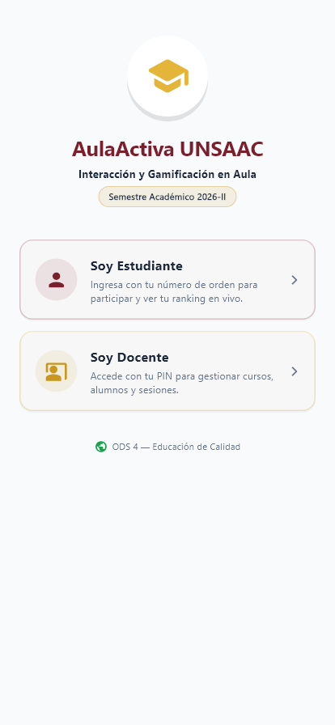 | 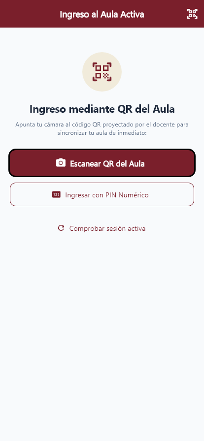 | 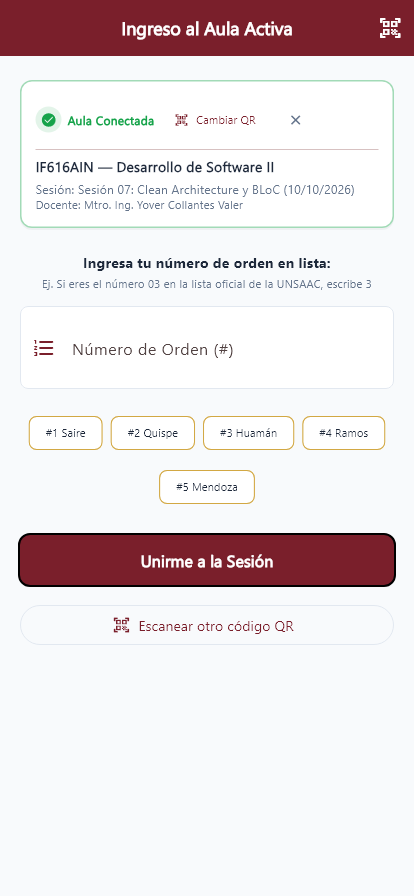 |

| Dashboard Estudiante (Podio) | Credencial Digital QR | Calculadora Vigesimal |
| :---: | :---: | :---: |
| 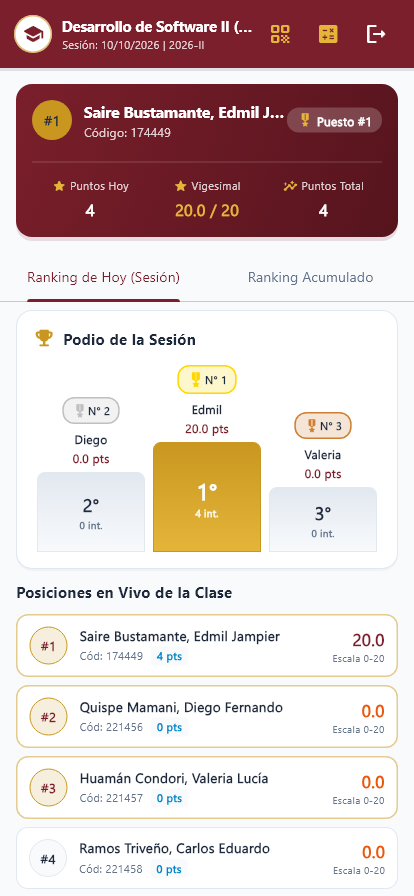 |  | 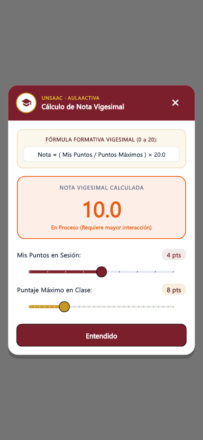 |

---

### 2. Gestión del Docente y Evaluación en el Aula
| Login Docente | Registro de Cuenta | Mis Cursos (Asignaturas) |
| :---: | :---: | :---: |
| 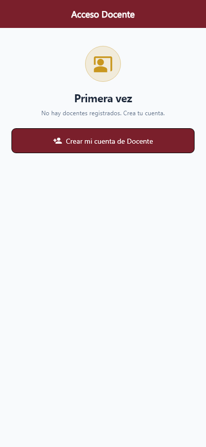 | 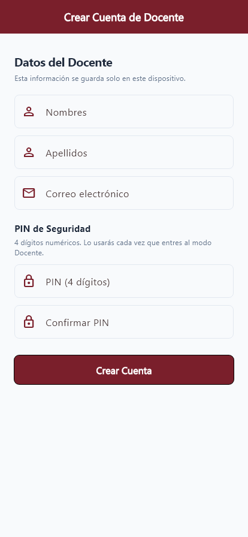 | 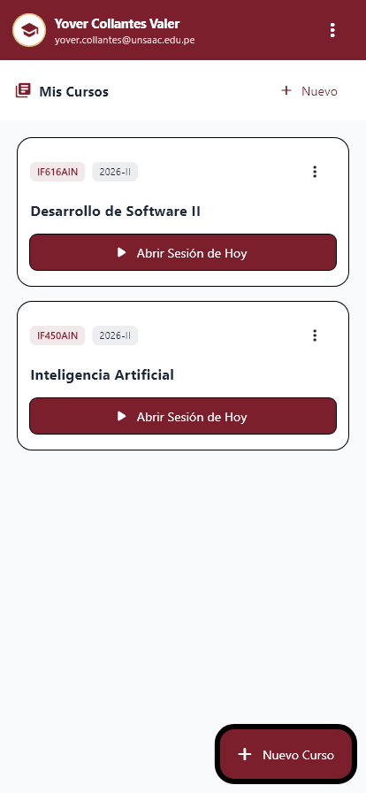 |

| QR de Aula Proyectado | Dashboard de Sesión con Excel | Modo Rápido (#) con Matriz Táctil |
| :---: | :---: | :---: |
| 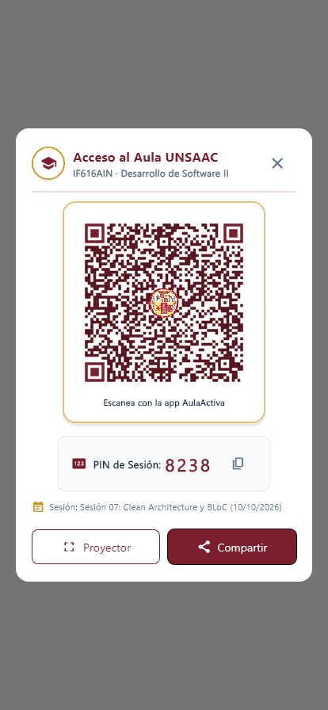 | 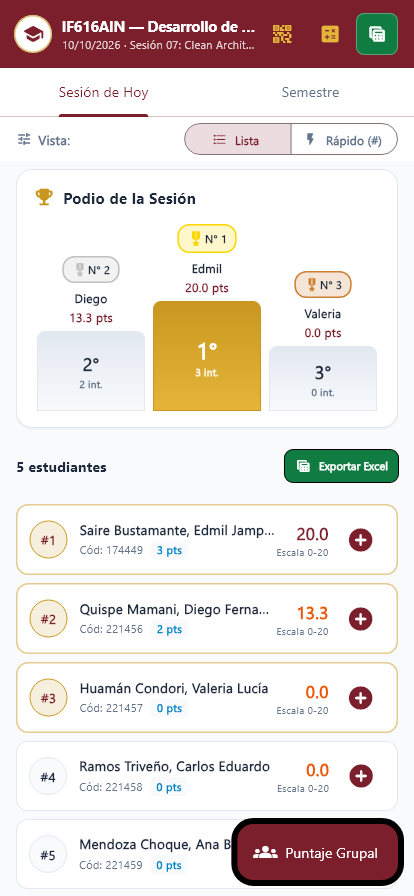 | 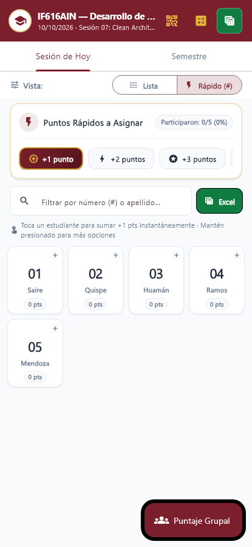 |

| Asignación Individual | Asignación Múltiple Grupal | Nómina Oficial de Alumnos |
| :---: | :---: | :---: |
| 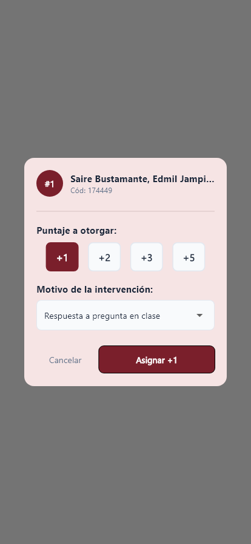 | 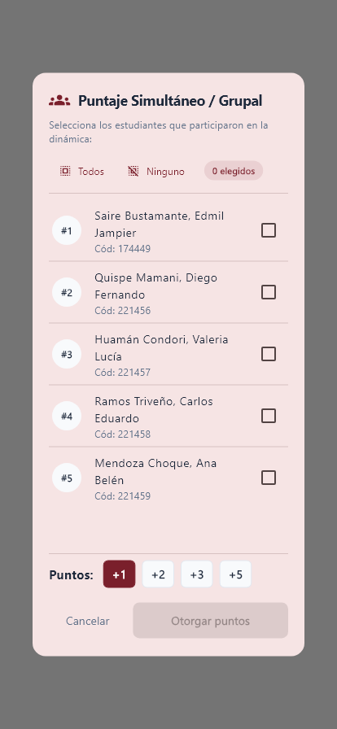 | 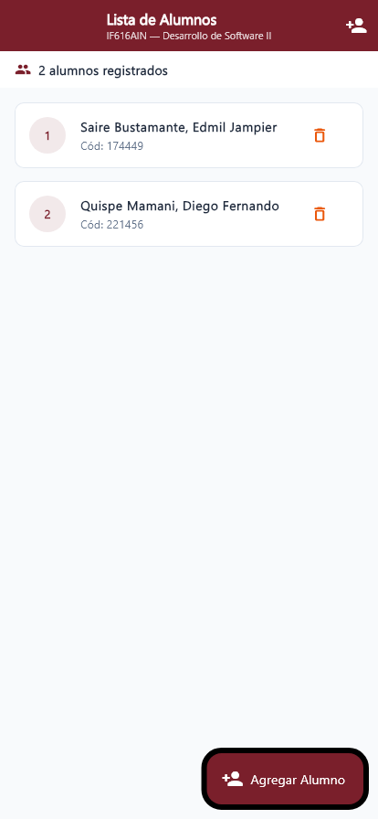 |

---

## 🧪 Suite de Pruebas Automatizadas

El proyecto fue sometido a una rigurosa suite de pruebas unitarias, de widgets y de generación visual en Flutter:

```powershell
$ flutter test
00:00 +0: (setUpAll)
00:00 +1: Verificación de carga inicial de AulaActiva UNSAAC
00:00 +2: Validación de control de concurrencia: bloqueo de celulares duplicados en un mismo número
00:01 +25: Modo Rápido (Matriz de Números) Renderiza selector de puntos y números de orden
00:01 +26: Modo Rápido: Al pulsar sobre un número en la matriz, asigna puntos inmediatamente
00:01 +27: CalculadoraVigesimalDialog renderiza fórmula, escudo UNSAAC y calcula nota proporcional
00:01 +30: 16 pruebas automatizadas de captura de pantalla en alta resolución
00:02 +41: All tests passed! (41 de 41 pruebas aprobadas al 100%)
```

### Análisis Estático (Linter)
```powershell
$ flutter analyze
Analyzing app_aula_activa...
No issues found! (ran in 2.8s)
```

---

## 🚀 Instrucciones de Instalación y Ejecución

### Prerrequisitos
- Flutter SDK 3.x o superior
- Android SDK instalado (para emulador o dispositivo físico)

### 1. Clonar el Repositorio
```bash
git clone https://github.com/milith0kun/desarrollo-de-software-2-primera-entrega.git
cd desarrollo-de-software-2-primera-entrega/app_aula_activa
```

### 2. Instalar Dependencias
```bash
flutter pub get
```

### 3. Ejecutar en Modo Desarrollo
```bash
flutter run
```

### 4. Ejecutar Todas las Pruebas
```bash
flutter test
```

### 5. Compilar el APK de Producción
```bash
flutter build apk --release
```

---

## 📊 Autoevaluación según Rúbrica Oficial UNSAAC (20 Puntos)

| Criterio Oficial | Evidencia Implementada | Puntaje | Autoev. |
| :--- | :--- | :---: | :---: |
| **Cobertura de widgets** | Uso de `TabBar`, `GridView`, `ListView.separated`, `PodioWidget`, `ModoRapidoMatrizWidget`, `QrImageView`, formularios y diálogos. | /4 pts | **4.0** |
| **Dominio del layout** | Cero errores de overflow, aplicación rigurosa de `Expanded`, `Wrap`, `SingleChildScrollView` y `TextOverflow.ellipsis`. | /4 pts | **4.0** |
| **Calidad de UI/UX** | Paleta oficial UNSAAC (`#7A1F2B`, `#C9971F`), botones táctiles con relieve, tipografía *Inter* y ausencia total de textos superfluos. | /4 pts | **4.0** |
| **Adaptabilidad** | Interfaz responsive adaptable a diferentes pantallas y orientaciones con espaciado modular de 8 dp. | /3 pts | **3.0** |
| **Accesibilidad y UX** | Zonas táctiles $\ge 48 \times 48\text{ dp}$, contrastes verificados, presencia en aula y avisos con `SnackBar`. | /2 pts | **2.0** |
| **Organización del código** | Clean Architecture modular, DTOs tipados, 41 pruebas automatizadas aprobadas y 0 advertencias de linter. | /2 pts | **2.0** |
| **Documentación y evidencias** | Informe en LaTeX de 21 páginas con 17 figuras en HD, exportador a Excel nativo, esquema SQL y APK Release. | /1 pt | **1.0** |
| **PUNTAJE TOTAL** | | **/20 pts** | **20.0** |
